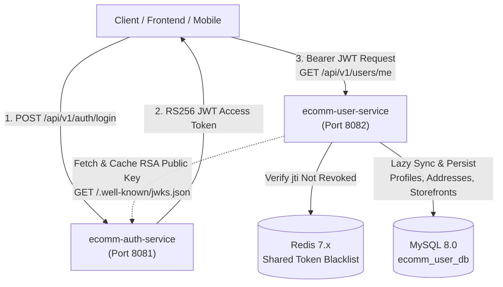

# E-Commerce User Profile, Address Book & Merchant Microservice (`ecomm-user-service`)

Enterprise-grade user profile, shipping/billing address book, and seller storefront microservice designed for distributed e-commerce ecosystems. Built with **Java 18**, **Spring Boot 3.4.x**, **Spring Security 6**, **MySQL 8.0**, and **Redis 7.x**, and integrated seamlessly with **`ecomm-auth-service`**.

---

## Architecture & Inter-Service Security



### Key Architectural Highlights
1. **Persona-Aware Unified User Profile (`GET /api/v1/users/me`)**:
   - **General Profile**: Manages `firstName`, `lastName`, `phoneNumber`, `avatarUrl`, `dateOfBirth`, `gender`, `bio`, `preferredLanguage`, `preferredCurrency`, and `marketingOptIn` for all user types.
   - **Customer Persona (`ROLE_CUSTOMER`)**: Automatically surfaces the user's **Shipping & Billing Address Book** (`addresses`), ordered with default shipping and billing addresses first.
   - **Seller / Merchant Persona (`ROLE_SELLER`)**: Automatically surfaces the merchant's **Seller Profile & Storefront Extension** (`sellerProfile`), including store name, slug, business registration, tax ID, customer support contacts, and verification status.
2. **Dedicated Database (`ecomm_user_db`) with Lazy Identity Sync**:
   - Keyed by the user's `uuid` (`sub`) and `email` from the JWT access token.
   - Automatically provisions a baseline `UserProfile` when a newly registered user from `ecomm-auth-service` accesses `ecomm-user-service` for the first time, and automatically syncs UUIDs for pre-seeded accounts (`customer@ecomm.com`, `admin@ecomm.com`, `seller@ecomm.com`).
3. **Zero-Trust JWT Verification & Instant Logout Enforcement**:
   - Dynamically fetches and caches the RSA 2048-bit Public Key from `ecomm-auth-service` (`GET /api/v1/auth/.well-known/jwks.json` with fallback to `/api/v1/auth/public-key` or static PEM key).
   - Automatically refreshes the cached public key if `ecomm-auth-service` rotates keys or restarts.
   - Checks the shared Redis blacklist (`auth:blacklist:{jti}`) so tokens revoked via `POST /api/v1/auth/logout` are immediately rejected across services.

---

## Pre-Seeded Test Personas

> [!WARNING]
> These test personas and sample records are for **local development and demonstration testing only**. In a production deployment, ensure test seeds are disabled or removed and real secrets are injected via your cloud secret manager.

Matching `ecomm-auth-service`, default user profiles, customer addresses, and verified merchant storefronts are automatically initialized via Flyway (`V2__seed_default_user_profiles.sql`) and `DataInitializer.java`:

| Persona | Email | Password (in Auth Service) | Pre-Seeded Extensions in `ecomm-user-service` |
|---|---|---|---|
| **Customer** | `customer@ecomm.com` | `Customer123!` | General profile + 2 shipping/billing addresses (`Home` default, `Office`) |
| **Seller (Merchant)** | `seller@ecomm.com` | `Seller123!` | General profile + Verified storefront `Bob Tech & Gadgets` (`bob-tech-gadgets`) |
| **Admin** | `admin@ecomm.com` | `Admin123!` | Admin profile + full access to `/api/v1/admin/**` user & seller management |

---

## REST API Endpoints

### 1. User Profile Endpoints (`/api/v1/users`)
| Method | Endpoint | Authorization | Description |
|---|---|---|---|
| `GET` | `/api/v1/users/me` | Authenticated | Get current user's persona-aware profile (includes `addresses` for customers and `sellerProfile` for sellers) |
| `PUT` | `/api/v1/users/me` | Authenticated | Update general profile information (name, phone, avatar, DOB, gender, bio, language, currency, marketing opt-in) |
| `GET` | `/api/v1/users/{uuid}` | `ROLE_ADMIN`, `ROLE_SUPPORT`, or Self | Get full persona-aware profile by user UUID |

### 2. Customer Shipping & Billing Address Book (`/api/v1/users/me/addresses`)
| Method | Endpoint | Authorization | Description |
|---|---|---|---|
| `GET` | `/api/v1/users/me/addresses` | Authenticated | List all shipping and billing addresses for the current user |
| `GET` | `/api/v1/users/me/addresses/{addressUuid}` | Authenticated | Get specific address details by UUID |
| `POST` | `/api/v1/users/me/addresses` | Authenticated | Add a new address (first address automatically becomes default shipping & billing) |
| `PUT` | `/api/v1/users/me/addresses/{addressUuid}` | Authenticated | Update an existing address |
| `PATCH` | `/api/v1/users/me/addresses/{addressUuid}/default` | Authenticated | Mark address as default shipping and/or default billing |
| `DELETE` | `/api/v1/users/me/addresses/{addressUuid}` | Authenticated | Delete an address (auto-promotes fallback default if needed) |

### 3. Seller / Merchant Profile & Storefront (`/api/v1/users/me/seller-profile` & `/api/v1/sellers`)
| Method | Endpoint | Authorization | Description |
|---|---|---|---|
| `GET` | `/api/v1/users/me/seller-profile` | `ROLE_SELLER` or `ROLE_ADMIN` | Get current seller's merchant storefront and business registration details |
| `PUT` | `/api/v1/users/me/seller-profile` | `ROLE_SELLER` or `ROLE_ADMIN` | Create or update current seller's storefront, business details, and policies |
| `GET` | `/api/v1/sellers/{slugOrUuid}` | **Public** | View public merchant storefront by `storeSlug` (e.g. `bob-tech-gadgets`) or UUID (redacts private tax/registration numbers) |

### 4. Admin & Support Management (`/api/v1/admin`)
| Method | Endpoint | Authorization | Description |
|---|---|---|---|
| `GET` | `/api/v1/admin/users` | `ROLE_ADMIN` or `ROLE_SUPPORT` | Paginated user search & filter (`?status=ACTIVE&role=ROLE_SELLER&search=bob&page=0&size=20`) |
| `PATCH` | `/api/v1/admin/users/{uuid}/status` | `ROLE_ADMIN` | Activate, suspend, or delete a user account (`ACTIVE`, `SUSPENDED`, `DELETED`) |
| `PATCH` | `/api/v1/admin/sellers/{sellerUuid}/verification` | `ROLE_ADMIN` | Approve, reject, or suspend a merchant storefront (`VERIFIED`, `REJECTED`, `SUSPENDED`) |

---

## End-to-End Quick Test (with `ecomm-auth-service`)

### 1. Obtain a JWT Access Token from `ecomm-auth-service` (Port 8081)
```bash
# Login as Customer (or Seller: seller@ecomm.com / Seller123!)
curl -X POST http://localhost:8081/api/v1/auth/login \
  -H "Content-Type: application/json" \
  -d '{
    "email": "customer@ecomm.com",
    "password": "Customer123!"
  }'
```

### 2. Query Persona-Aware User Profile on `ecomm-user-service` (Port 8082)
```bash
curl -X GET http://localhost:8082/api/v1/users/me \
  -H "Authorization: Bearer <YOUR_ACCESS_TOKEN>"
```

### 3. Add a New Shipping Address (Customer)
```bash
curl -X POST http://localhost:8082/api/v1/users/me/addresses \
  -H "Authorization: Bearer <CUSTOMER_ACCESS_TOKEN>" \
  -H "Content-Type: application/json" \
  -d '{
    "label": "Work",
    "recipientName": "Alice Customer",
    "phoneNumber": "+1000000001",
    "addressType": "SHIPPING",
    "streetLine1": "1600 Amphitheatre Parkway",
    "city": "Mountain View",
    "stateProvince": "CA",
    "postalCode": "94043",
    "countryCode": "US",
    "defaultShipping": true
  }'
```

### 4. View Public Merchant Storefront (No Auth Required)
```bash
curl -X GET http://localhost:8082/api/v1/sellers/bob-tech-gadgets
```

---

## Running & Deploying

### Option 1: Podman Deployment (`deploy-podman.ps1`)
Automatically detects if `ecomm-auth-pod` is running, creates `ecomm_user_db` inside the shared MySQL instance, and starts `ecomm-user-service` on port `8082`:
```powershell
.\deploy-podman.ps1
```

### Option 2: Docker Compose
```bash
docker compose up -d --build
```

### Option 3: Local Maven Build & Test
```bash
mvn clean test
mvn package -DskipTests
java -jar target/user-service-1.0.0-SNAPSHOT.jar
```

